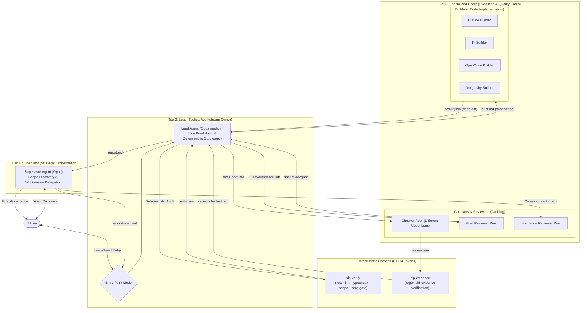
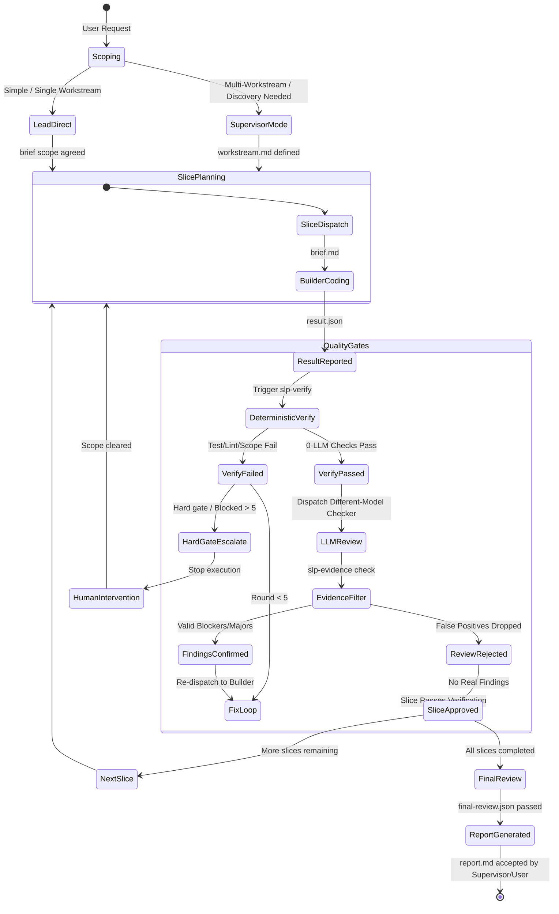

# paseo-slp

Per-role harness for Paseo agents (Supervisor / Lead / Peers). Spec: `SLP-SPEC.md`.

## Architecture & Flow Overview

### 1. High-Level 3-Tier Multi-Agent Hierarchy



### 2. End-to-End Execution Sequence & Verification Lifecycle

```mermaid
sequenceDiagram
    autonumber
    actor User as 👤 User
    participant Sup as 🧭 Supervisor (Opus)
    participant Lead as 👔 Lead (Opus)
    participant WT as 📂 Git Worktree (.slp/)
    participant Bld as 🛠️ Builder (Peer)
    participant Ver as ⚡ slp-verify (Deterministic)
    participant Chk as 🔍 Checker (Peer)
    participant Evi as 🛡️ slp-evidence (Deterministic)
    participant Fin as 🏁 Final Reviewer

    rect rgb(30, 41, 59)
    note over User, Sup: Phase 1: Discovery & Scoping
    User->>Sup: Request feature / Complex multi-workstream task
    Sup->>Sup: Discovery (Grill, Options, Edge cases)
    Sup->>WT: Write .slp/workstream.md (scope, acceptance, gates)
    Sup->>Lead: Spawn Lead agent
    end

    rect rgb(15, 23, 42)
    note over Lead, Ver: Phase 2: Slice Execution & Deterministic Verification
    Lead->>Lead: Break workstream into slices (<= 8 files)
    Lead->>WT: Write .slp/slices/<id>/brief.md (with inline code context)
    Lead->>Bld: Dispatch Builder (isolated branch, push blocked)
    Bld->>Bld: Implement code + run local slice tests
    Bld->>WT: Write .slp/slices/<id>/result.json
    Bld-->>Lead: Hand-off completed slice
    Lead->>Ver: Execute slp-verify <worktree> <slice-id>
    Ver->>Ver: Run repo test + lint + typecheck + scope check
    Ver->>WT: Write .slp/slices/<id>/verify.1.json
    Ver-->>Lead: Verdict (pass | fail | block)
    end

    rect rgb(30, 41, 59)
    note over Lead, Evi: Phase 3: Different-Model Review & Evidence Filtering
    Lead->>Chk: Dispatch Checker (Different model than Builder; Sonnet builder -> DeepSeek checker)
    Chk->>Chk: Multi-lens review (business, security, perf, scale)
    Chk->>WT: Write review.1.json
    Lead->>Evi: Run slp-evidence review.1.json
    Evi->>Evi: Verify line numbers & quote evidence in diff
    Evi->>WT: Write review.1.checked.json (filter hallucinated issues)
    opt If issues detected (Fix Loop)
        Lead->>Bld: Re-dispatch with review findings (Round 1-3 DeepSeek, 4-5 Sonnet)
    end
    end

    rect rgb(15, 23, 42)
    note over Lead, User: Phase 4: Integration, Final Review & Reporting
    Lead->>Lead: Merge slice branch into workstream branch locally
    Lead->>Fin: Dispatch Final Reviewer on full workstream diff
    Fin->>WT: Write final-review.json
    Lead->>WT: Write .slp/report.md (summary, metrics, acceptance checklist)
    Lead-->>Sup: Report workstream completion
    Sup->>User: Deliver verified result with audit trail
    end
```

### 3. State Machine & Escalation Loop



## Design principles (v2 adjustments, motivated by vhlam.com "agent orchestration multi-agent SLP")
- Roles are defined by responsibility / authority / escalation, not persona. One owner per changing scope (one writer per
  file set). Edit rights are not challenge rights: a Builder may not edit outside `files`, but may challenge the brief.
- **When NOT to use SLP**: small changes (<= ~2 files, no hard gate) and work needing continuous human feedback (UI/UX feel,
  visual polish, game feel). Supervisor and Lead tell the user to chat directly with one builder profile
  (`slp-builder-deepseek` for FE, `slp-builder-sonnet` otherwise).
- **No debate-reward prompts**: the Advisor is an independent second opinion ("no objection, proceed" is a valid answer; it
  challenges a premise only when evidence warrants). No role is told to "find holes" or play devil's advocate; "no
  findings" is a valid review. A test (`test_no_debate_reward_wording_in_roles_and_skills`) guards the wording.
- **Version-pinned evidence**: `verify.json` carries `head_sha` (full SHA of the verified HEAD) and `base_ref`; `review.json`
  / `final-review.json` carry required `head_sha` + `base_ref` (checkers run `git rev-parse HEAD`; the Lead's prompt names
  the verified SHA). `slp-evidence` rejects the WHOLE review as `status: stale` (exit 1, all findings to `rejected[]`) when
  `head_sha` != the worktree's current HEAD; `--allow-stale` is for diagnostics (findings judged, status still `stale`).
  A verify/review is valid only for the SHA it names: any new commit needs a new verify and review.
- **Brief in three parts** (`templates/brief.md`): `goal` (outcome, why), `constraints[]` (binding: hard gates, invariants;
  `files`, `tests_must_pass`, `out_of_scope` are binding too), `design_choice` (the Lead's proposal, explicitly
  challengeable). All three are required front-matter (old two-field briefs are not accepted). Do not pre-solve.
- **`scope_challenge`** (optional in `result.json`): `{premise, evidence, proposal}`. A Builder disputes the design_choice or
  scope with evidence instead of silently complying or deviating; it never allows edits outside `files`, and status
  `needs_input` is used when the goal/constraints cannot be met without it. `slp-verify` shows it in the `contract`
  evidence; the Lead must accept (new brief) or reject (reason to the Builder and in `report.md`) before the next round.
- **Review metrics**: `report.md` `metrics.reviews[{reviewer_profile, findings_total, findings_accepted, changed_outcome}]`
  (required; optional `slice`, `round`). `changed_outcome` = at least one accepted finding led to a code change before
  acceptance. `bin/slp-metrics <dir|report.md>... [--json]` prints per reviewer profile: reviews, change rate,
  rejected-by-evidence rate. Low change rate + high rejected rate = candidate to drop that reviewer ("Better-SLP" input).

## Layout
- `roles/<role>/role.md` role prompt (EN, <= 60 lines, line 1 = `ROLE-MARKER: slp-<role>`)
- `roles/<role>/policy.yaml` harness policy (write / bash / paseo_tools / skills_auto / deny_tools / probe; optional `spawn_allow`, `pi_exclude_tools`, `git_push_block`, `models`)
- `roles/extra_skills.yaml` bundled skills (not in `~/.claude/skills`) that are switched off in Claude roles
- `bin/slp-build` generates `build/` + provider JSON and installs the slp-* skills; `bin/slp-conformance` probes every provider
- `bin/slp-claude` launcher of every Claude-family slp-* provider: merges Paseo's `--settings` with the role settings (see "Why bin/slp-claude")
- `skills/slp-lead/`, `skills/slp-supervisor/` operating playbooks (symlinked into `~/.claude/skills` by `slp-build --apply`)
- `bin/slp-verify` / `bin/slp-evidence` / `bin/slp-validate` deterministic verification tools (see below)
- `bin/slp-merge <worktree> --into <test|master|develop> [--push]` the Lead's only way to merge and push into protected branches (user decision 2026-10-28; all repos). Policy `protected_merge` in `roles/lead/policy.yaml` (`branches`, optional `roots` / `deny_roots`, `push`), read from this checkout, no env override. Needs a `checked` + `pass` final review whose `head_sha` equals the branch HEAD, source and target worktrees clean for tracked files, the target already checked out (never checks out, pulls or resets). `--no-ff` merge, `.slp/merge.json` (incl. `pushed`). With `--push`: upstream required, fetch and local == remote required, source pushed BEFORE the merge, then the target; never forced; a failed target push keeps the local merge, exits 1 and the Lead escalates. It strips inherited `GIT_*` env (incl. the `pushInsteadOf` push block), which is why its push works while raw `git push` stays blocked. Exit 0 ok, 1 refused/conflict/push failed, 2 error
- `bin/slp-metrics` aggregates `report.md` review metrics per reviewer profile (see "Design principles")
- `schemas/` JSON Schema (draft 2020-12) for every artifact; `templates/` one valid example of each
- `repos/_default.yaml` hard-gate + sandbox-escape patterns (DRAFT); `repos/TEMPLATE.yaml` per-repo config
- `lib/` shared Python modules (`slp_schema`, `slp_git`, `slp_rules`, `slp_policy`, `slp_paseo`, `slp_skills_install`, `slp_git_push_block`, `slp_probes`) + `paseo_remove_project.mjs`
- `tests/` unittest suite over throw-away fixture git repos
- `hooks/slp-guard.py` Claude PreToolUse guard (Bash / Edit / Write / Paseo spawn tools) + SessionStart prompt delivery
- `build/` generated, never hand-edit. `conformance/` probe results.

## Workflow
1. Edit `roles/<role>/role.md` or `policy.yaml` (single source per role).
2. `bin/slp-build` dry run: writes `build/`, prints providers JSON + diff vs `~/.paseo/config.json`.
   Optional `models` in a policy (list of `{id, label, isDefault?}`, at most one default) is copied into that provider
   entry: slp-* entries are replaced wholesale on `--apply`, so a user-set model list would otherwise be dropped
   (`opencode-builder` carries DeepSeek V4.1 Flash (FE + BE, default); `opencode-checker` carries DeepSeek V4.1 Flash as checker).
3. `bin/slp-build --apply` (`--only-claude`: just the Claude-family providers) writes ONLY `agents.providers.slp-*` (+ the `antigravity` override: command / paseoTools / label / env) in `~/.paseo/config.json`,
   and REMOVES every `slp-*` key that has no role any more (logged as `stale slp-* providers ... removed`; other keys are never
   touched, and `--only-claude` removes nothing),
   installs the skills (below), then `paseo reload`. No config backup is written: review the dry-run diff first.
   (Claude settings/policy files are read at agent start; only provider argv/env need the reload.)
4. `bin/slp-conformance [--roles a,b] [--profiles id,id] [--thinking medium] [--cheap] [--ignore-skip]` spawns one probe per provider.
   EVERY role (all families) runs on the REAL model/mode/thinking of its `daemon.agentProfiles` entry (`--profile-models`, the
   default): `probe.profile` in `policy.yaml` maps role -> profile id (or a list of ids). A role with several profiles gets one
   probe per profile, variant `role@<profile id>` (e.g. `claude-checker@slp-checker-sonnet`, `claude-checker@slp-checker-opus`);
   a role without `probe.profile` takes every profile on its provider. Provider/model/modeId/thinkingOptionId come from the
   profile (`paseo run` has no flag for `featureValues`: they are reported with a warning, not applied; no profile uses them
   today). `--cheap` falls back to the cheap `probe.model` (and `probe.thinking`, when set) of every role (`claude-advisor` uses it before its
   profile `slp-advisor-sonnet` exists: model `claude-sonnet-5-5`, thinking `high`); `--thinking` caps the effort of Claude profiles only;
   `--profiles` limits the run to variants of those profile ids; `--ignore-skip` drops `probe.skip_reason` (attempt a quota-blocked
   role once: a provider error stays UNVERIFIED with the error text). Run big sets in smaller batches: 14 parallel probes made
   agy / pi time out once (6 min `--wait-timeout`), the same probes passed alone. (Read-only roles also get an
   `@bypass` probe so plan mode cannot mask the harness), judges from the filesystem + self-reports,
   writes `conformance/conformance-<ts>.json`, archives probe agents, exits 1 on any FAIL.
   Run it after every build, Paseo update, mobio-kit update or profile change.
   All probes share ONE scratch cwd (`.scratch/conformance`, gitignored; probe files are named per variant) so
   Paseo creates a single workspace/project. At the end the probe agents are archived and the scratch project
   is removed via the daemon API (`lib/paseo_remove_project.mjs`, installed CLI client `removeProject`) and the
   scratch dir is deleted. The Lead probe also proves `slp-verify` / `slp-evidence` can run (output files on disk)
   while any other bash is blocked.
   The scratch dir is a throw-away git repo with a second worktree (`wt-sibling`) inside it: the Lead probe must be able
   to write `wt-sibling/.slp/` but not `wt-sibling/` source files; checker roles must write only their own `.slp/review.*`
   file (not the sibling's, not elsewhere; bash writes blocked).
   Result files never overwrite each other (`-2` suffix within the same minute).
   Hardening probes (see the sections below): `supervisor@spawn` / `lead@spawn` (spawn whitelist, plus a no-LLM
   `spawn_hook` check that runs the real hook command), `claude-*@tools` (AskUserQuestion), `pi-builder@tools`
   (Pi tool lockdown), `agy-builder@git_push`. Spawn-probe children (titled
   `slp-conf-*`) are archived with the other probe agents.

Python: `~/.claude/skills/.venv/bin/python3` (stdlib + PyYAML). Profiles are NOT switched by these tools.

## Git-level push block (`git_push_block: true`)
Set on `claude-builder`, `pi-builder`, `opencode-builder`, `agy-builder`. `slp-build` adds to those providers' `env` (merged with any
existing `GIT_CONFIG_*` / policy `env:` pairs and renumbered; idempotent; `lib/slp_git_push_block.py`):
`GIT_CONFIG_COUNT=9` and for i in 0..8 `GIT_CONFIG_KEY_i=url.nopush:///.pushInsteadOf` with `GIT_CONFIG_VALUE_i` =
`git@`, `https://`, `http://`, `ssh://`, `file://`, `/`, `./`, `../`, `git://`. Every push URL is rewritten to the
non-existent `nopush` transport, so git itself fails (`remote helper 'nopush' aborted session`) no matter how the push
is spelled (alias, `git -c`, script, `-C`); `fetch` / `commit` are unaffected. `./`, `../`, `git://` go beyond the
required list (relative-path and git:// remotes would otherwise slip through).
- Known limits: git does NOT apply `pushInsteadOf` to an explicit `remote.<n>.pushurl`; an agent that sets one, unsets the
  env (`env -u`, `GIT_CONFIG_COUNT=0 git push`) or uses a non-git client is not stopped by this layer. Claude keeps the
  guard-hook deny on `git push`, Pi relies on this layer + `slp-verify`.
- OpenCode: the env is added too, but it is NOT reliable there. Paseo's `OpenCodeServerManager` is a process-wide
  singleton (fork `packages/server/src/server/agent/providers/opencode/server-manager.ts:120-138`): the first
  OpenCode-family client fixes the runtime settings (later providers only get a warning) and `startServer` builds the
  shared server env from them (`:338-342`). Per-provider env therefore reaches `opencode serve` only if
  `slp-opencode-builder` was constructed first. A dedicated server is used only for per-agent launch env / MCP servers
  (`opencode-agent.ts:358-361`, `:1608-1613`), which does not carry provider env. So the OpenCode agent additionally gets
  bash permission `"*git*push*": deny` (last rule, after `"*": allow`; existing deny rules kept) and OpenCode relies on
  that pattern only (it does not catch a push hidden in a script).
- Antigravity: the block goes into the `env` of the `antigravity` override (`slp-build` merges it key by key into the
  live entry: foreign keys and foreign `GIT_CONFIG_*` pairs survive, ours are never duplicated; idempotent). Verified from
  the fork source that provider env reaches the agy process: config `env` -> `extractAgentProviderSettings`
  (`server/config.ts`) -> `PluginAgentClient(registration, runtimeSettings)` -> `resolveLaunch()` `createProviderEnv`
  (`agent/plugin-provider.ts`) -> `startDriver` spawns `agy` with `{...launch.env, ...config.env}`
  (`plugins/antigravity-provider/server/internal/process.ts`). `agy-builder@git_push` runs the same two push attempts
  through `paseo run --provider antigravity` (no `--output-schema` for plugin providers: JSON is requested in the prompt
  and read from `paseo logs`).
- Tests: `tests/test_git_push_block.py` (fixture repos, local bare remote via `file://`, plain and relative path:
  push fails with `nopush`, fetch/commit work; env merge; OpenCode rule order; conformance judge).
- Conformance: `claude-builder@git_push` / `pi-builder@git_push` run `git push origin HEAD` and
  `git -c alias.pp=push pp origin HEAD` in a scratch repo whose `origin` is a local bare repo (`file://`). PASS =
  the bare repo did not receive the commit (checked from the filesystem, with a control push proving the fixture works);
  the evidence says whether the `nopush` error (git layer) or another layer stopped it. `opencode-builder@git_push` is
  UNVERIFIED while its probe has `skip_reason` (quota).

## Spawn whitelist for Supervisor and Lead (`spawn_allow`)
Paseo's MCP tools `create_agent` / `update_agent` / `set_agent_mode` are otherwise unrestricted. Claude sees them as
`mcp__paseo__<tool>` (the daemon injects its MCP server under the name `paseo`, `agent/runtime-mcp-config.ts`; the guard
matches the final `__<tool>` segment, so a renamed server is still policed). Roles with a `spawn_allow` list get a
PreToolUse hook (`matcher: mcp__paseo__create_agent|mcp__paseo__update_agent|mcp__paseo__set_agent_mode`,
`slp-guard.py --role <r> || exit 2`):
- `create_agent`: allowed only when the provider part of `tool_input.provider` (`provider` or `provider/model`; split at the
  FIRST slash like Paseo, trimmed, exact match, case sensitive) is in `spawn_allow`;
- `update_agent` and `set_agent_mode`: always blocked;
- anything unparsable (bad JSON, non-dict input, missing/non-string provider, non-string tool name, missing allow list)
  blocks (exit 2).
Allow lists: `supervisor` -> `slp-lead`, `slp-claude-integration-reviewer`, `slp-claude-advisor`; `lead` -> `antigravity`,
`slp-opencode-builder`, `slp-claude-builder`, `slp-pi-builder`, `slp-claude-checker`, `slp-opencode-checker`,
`slp-claude-final-reviewer`, `slp-claude-advisor`. `slp-build` rejects an empty list or an id that is no role's `provider_id`.
Known gap: `send_agent_prompt` accepts `sessionMode` (a mode switch on an existing agent) and is not covered.
Conformance: `spawn_hook` (no LLM) runs the real hook command (allowed ids rc 0; `claude/...`, `update_agent`,
`set_agent_mode`, no provider, garbage stdin rc 2); `@spawn` probes make the live agent try a denied create, update,
set_agent_mode (the block text must contain `SLP guard`; `paseo ls` must show no denied child) and one allowed create
(a cheap haiku child must exist). The denied provider of the live probe defaults to `claude/claude-haiku-5-5`; a role can set
`probe.spawn.denied` (the supervisor uses the removed `slp-codex-advisor`, and `spawn_hook` also asserts it is refused).

## Worker tool lockdown
- Claude peers (`claude-builder`, `claude-checker`, `claude-final-reviewer`, `claude-integration-reviewer`, `claude-advisor`):
  `permissions.deny` now also has `AskUserQuestion` and `ExitPlanMode` (deny holds under `bypassPermissions`; an unanswered
  user prompt or plan approval would hang the worker). Supervisor and Lead keep `AskUserQuestion`. Conformance
  `claude-*@tools`: settings deny both, the tool is not in the agent's tool list and a call is not possible (`ask_user`).
- Pi builder: `--exclude-tools subagent*,contact_supervisor,bg_wait,ask_user_question,web_*,memongo_*` in the provider
  command (policy `pi_exclude_tools`; NOT `--no-mcp`, `--exclude-tools` is a name/glob denylist that also reaches MCP tools but
  these patterns match none of them). Real tool names in this install (pi 1.3.0, probed with a throw-away extension
  calling `pi.getAllTools()`): built-in `read bash edit write` (active) + `grep find ls powershell` (inactive) +
  `codemode tool_search`; pi-subagents `subagent subagents_enable subagent_supervisor contact_supervisor bg_wait`;
  rpiv `ask_user_question`, `todo`; donsetch `web_fetch web_search web_crawl web_screenshot`; memongo
  `memongo_search memongo_save memongo_status`. Active by default before the change: read, bash, edit, write, memongo_*,
  bg_wait, subagents_enable, ask_user_question, todo, web_*, subagent_supervisor. After: read, bash, edit, write, todo.
  Re-probe after `pi update` / new packages. Conformance `pi-builder@tools`: the LIVE argv carries the exact value and the
  agent's tool list contains read/write/edit/bash and no excluded name.

## Why bin/slp-claude (Opus ran with NO harness)
Paseo passes its own `settings` object (`{fastMode, ultracode?, disableAllHooks?}`) to the Claude Agent SDK for models that
support fast mode (`supportsFastMode` in `model-manifest.ts`: Opus 4.6 - 5.5, NOT Sonnet 5/5.5, Haiku, Fable, Mythos), see
`buildSettingsOptions` in `paseo-vietnamese-voice/packages/server/src/server/agent/providers/claude/agent.ts` (lines 3568-3593).
The SDK turns it into `--settings <json>`, and `query.ts` (`resolveClaudeSpawnCommand`) launches
`<provider argv> <SDK args>`, so Paseo's `--settings` comes LAST and shadows our `--settings <role.json>`:
the Opus agent ran with no `permissions.deny`, no hooks (guard, SessionStart role prompt), no `skillOverrides`.
`params/options.settings` cannot carry hooks/skillOverrides (strict schema), and the fork is not patched.
Conformance with haiku (no fast mode) passed falsely; conformance now defaults to the profile models of every family.

`bin/slp-claude --slp-role-settings <role.json> [claude args]` is now `command[0]` of the Claude providers. It gathers every
`--settings` (`--settings X` / `--settings=X`, JSON string or path), deep-merges them (Paseo first, role last: permissions
lists concat + dedupe, hooks appended per event, `skillOverrides` and other keys role wins, `fastMode` / `ultracode` /
`disableAllHooks` stay as Paseo set them) and passes ONE inline `--settings <json>` (no temp files to clean) through `os.execv`,
so stdio, `--version` and `auth status` behave as with plain claude. A missing/invalid role file exits 2 without starting
claude (fail closed). `SLP_REAL_CLAUDE` overrides the real binary lookup (default: first `claude` on PATH that is not the wrapper).
Tests: `tests/test_slp_claude.py`.

### Model-dependent override audit of the other families (fork `paseo-vietnamese-voice`, 2026-10-21)
Only Claude had an SDK-injected argv that shadows ours. No equivalent was found for the others (paths under `packages/server/src/server/agent/providers/` unless noted):
- Antigravity (`plugins/antigravity-provider/server/internal/process.ts:34-48`): argv = our `agy --agent slp-agy-builder` + fixed flags +
  `--model <m>` only; `mode` (`full-access`) never reaches argv (`session.ts:57`, only the session-reuse key `process.ts:30`).
- Pi (`pi/runtime.ts:118-144`): appends `--mode rpc`, `--model`, `--thinking` (profile value only), `--session`, `--extension <paseo ext>`;
  never `--tools`, `--exclude-tools`, `--append-system-prompt`. The Paseo extension only appends to the system prompt
  (`pi/agent.ts:709`), it does not touch tools.
- OpenCode (`opencode-agent.ts:3683-3697`): per prompt `model`, `agent` (= modeId, so `slp-builder` selects our agent), `variant`, `system`.

## Role prompt precedence
Every role.md has a short "Precedence" block: peers (builders, checkers, reviewers, advisor) are workers that never ask the
user (even if a global rule says AskUserQuestion), never index/scan the whole repo (ignore `index_repository` reminders from
global hooks) and read only what the brief/diff needs; Lead/Supervisor do not run `index_repository` on whole repos unless
the task needs it. `daemon.appendSystemPrompt` reaches every family (Claude, OpenCode, Pi, Antigravity as the first
user message), so the Pi/Antigravity/OpenCode builder prompts say the shared rules "also reach you" and keep the Mobio
invariants inlined as a second channel.

## Skills install (`slp-build --apply`)
- Symlinks `skills/slp-*` into `~/.claude/skills/<name>` (only `slp-*` names; a stale or dangling `slp-*` symlink is
  replaced/removed; a real directory with that name is refused; other skills are never touched).
- `~/.claude/settings.json`: ensures ONLY `skillOverrides["slp-supervisor"]` and `["slp-lead"]` = `user-invocable-only`
  (global default: hidden in normal sessions). The dry run prints the exact diff; other keys are re-serialized only.
- Per role, `build/claude/<role>.settings.json` sets EVERY `skills_auto` entry explicitly to `"on"` (supervisor gets
  `slp-supervisor`, lead gets `slp-lead`), so the global `user-invocable-only` does not hide them; all other known
  skills are `"off"`.

## Paseo CLI resolution
Scripts that call the Paseo CLI/client (`bin/slp-conformance`, `bin/slp-build` reload, `lib/paseo_remove_project.mjs`)
use `lib/slp_paseo.py`: env `PASEO_CLI` if set; else the sibling fork CLI
`<WORKSPACE_DIR>/paseo/packages/cli/bin/paseo` when its `dist/index.js` exists; else
`/opt/homebrew/bin/paseo` with a warning (it may be older than the daemon, 0.10.3 vs 0.11.2, and rejects the current
config). The `removeProject` client import follows the same order (`<cli>/dist/utils/client.js`; `SLP_PASEO_CLI_DIST`
overrides).

## Guard rules (`hooks/slp-guard.py`, driven by `roles/<r>/policy.yaml`)
- Bash modes: `none`; `allowlist` / `readonly` (regex allowlist over the normalized segment; no redirections,
  substitutions, `;` `&&` `||` `|` `&`, newlines or nested shells; NO env prefix / `sudo` / `env` / `command`
  wrappers, so `VAR=x slp-verify` is refused); `all-except` (builders: deny patterns for `git push`, `reset --hard`,
  `branch -D`, merge/rebase/pull/checkout of protected branches, destructive `rm`; wrappers are stripped first).
  Absolute paths of `slp-verify` / `slp-evidence` / `slp-merge` under `paseo-slp/bin/` match as the bare name.
  Raw `git merge` / `push` / `commit` stay blocked for the Lead; `slp-merge` is the sanctioned path for test/master/develop.
- git branch protection uses the directory of `git -C <dir>` (so a Lead in the main checkout can run
  `git -C <worktree> merge <slice-branch>`); `--git-dir` / `--work-tree` are refused.
- `write: slp-only`: `Write|Edit|MultiEdit` only under `.slp/` after `realpath` (symlinks and `..` cannot escape);
  `NotebookEdit` always refused. `slp_scope: cwd` (Claude checkers/reviewers) = `.slp/` of the agent's own workspace;
  `slp_scope: repo` (Lead) = `<toplevel>/.slp/` of ANY worktree whose
  `git rev-parse --path-format=absolute --git-common-dir` equals that of the cwd / `CLAUDE_PROJECT_DIR`
  (sibling worktrees yes, other repos no, `src/` never).
- Paseo MCP spawn tools (`mcp__paseo__create_agent|update_agent|set_agent_mode`): see "Spawn whitelist" below; fail closed.
- Claude checkers/reviewers (`claude-checker`, `claude-final-reviewer`, `claude-integration-reviewer`): write
  `slp-only` (their own `review.<round>.json` / `final-review.json` / `integration-review.json`), bash `readonly`,
  probe mode `bypassPermissions` (profiles still in `plan` mode refuse the write; switch them).
  `claude-advisor` (provider `slp-claude-advisor`, profile `slp-advisor-sonnet`): `write: none` (permissions.deny on
  Edit/Write/MultiEdit/NotebookEdit), bash `readonly`, answers in chat (plain text, <= 40 lines); the Supervisor and the Lead
  may spawn it.
- Model routing (2026-10-23, `build/model-selection-2026-10.md`): Supervisor Opus 5.5; Lead Opus 5.5 medium; builders FE and
  BE = `slp-builder-deepseek` (fallback `slp-builder-sonnet`; `slp-builder-pi-flash` then `slp-builder-flash` are last-resort FE
  fallbacks only; Kimi K3 via Zen is a future option for aesthetics-heavy FE, not configured). Checkers: a
  non-Claude builder is checked by `slp-checker-sonnet` (`slp-checker-opus` when high-risk); a Sonnet builder by
  `slp-checker-deepseek`. Final reviewer Opus high, advisor Sonnet.
- `opencode-checker` (provider `slp-opencode-checker`, OpenCode agent `slp-checker`, profile `slp-checker-deepseek`, model
  `opencode-go/deepseek-v4.1-flash`): `write: none` (OpenCode `edit: deny`), bash allowlist. It CANNOT write files: its final
  message is ONE compact review JSON that the Lead saves to `.slp/slices/<id>/review.<N>.json` before running `slp-evidence`.
  Generated `permission.bash` order (OpenCode: the LAST matching rule wins): `"*": deny`, the `bash_allow` globs (`git
  diff|log|show|status|rev-parse`, `git branch --show-current`, `cat ls rg grep head tail wc`), then the `bash_deny` globs
  (`--output`, `--pre`, `--ext-diff`, `--textconv`, `>`, `$(`, backtick), plus `task: deny`, `webfetch: deny`, `edit: deny`,
  `steps: 40`. For OpenCode roles `bash_allow` / `bash_deny` are globs (the Claude guard uses regexes).

## Known wiring facts (Paseo 0.11.2 / Claude 2.1.299)
- Claude: Paseo's own `--append-system-prompt` wins over ours; the role prompt reaches the model through the
  SessionStart hook (marker `ROLE-MARKER-HOOK:`). Our flag is kept as a harmless first channel.
- OpenCode: Paseo's server manager is a process-wide singleton; per-provider `env` is ignored for mode
  discovery (and unreliable for the shared server, see the git push block), so `modeId: slp-builder` is rejected ("Available modes: build, plan, brainstormer").
- Antigravity: Paseo rejects `extends: "antigravity"`, so slp-build OVERRIDES the built-in plugin provider key
  `agents.providers.antigravity` = `{command: ["agy","--agent","slp-agy-builder"], paseoTools: {enabled: false}}`
  (an entry without `extends` is a plain override; verified on a throw-away 0.11.2 daemon: argv = `agy --agent
  slp-agy-builder` + Paseo's flags). Consequence (accepted): EVERY Antigravity agent started via Paseo is the SLP
  builder. `antigravity` is the only non-slp key slp-build writes, and only its command/paseoTools/label/env fields.
  `--apply` also installs `build/antigravity/slp-*.md` into `~/.gemini/config/agents/` (checks `agy agents`). Note: the global `/opt/homebrew/bin/paseo` (0.10.3) CLI rejects
  such a config; use the 0.11.2 CLI for `daemon start --home`. The plugin has no `prompt.output_schema`, so the
  conformance probe reads the JSON from `paseo logs`. Probe conversations are deleted via their summary row
  (workspace_uris = scratch dir); empty-workspace `slp-agy-builder` rows come from Paseo's catalog calls and stay.
- Gaps: Pi skills are not controllable here.

## Verification tools (P2)
Run with `~/.claude/skills/.venv/bin/python3` (shebang already set). Needs PyYAML + jsonschema (both in that venv).

`bin/slp-verify <worktree> <slice-id> [--round N] [--repo-config PATH]` (0 LLM). Reads
`.slp/slices/<id>/brief.md` front-matter, diffs `base_ref...HEAD` + uncommitted + untracked, writes
`.slp/slices/<id>/verify.<round>.json` (default round = next free; the file pins `head_sha` and `base_ref`). Exit 0 pass, 1 fail, 3 block, 2 usage/internal.
`bin/slp-verify --init <worktree>` appends `.slp/` to `<git common dir>/info/exclude` (idempotent, exit 0, prints what
it did); run it once per worktree (the Lead is allowed to).

Checks: `test` `lint` `typecheck` (repo config; missing => `unconfigured`, never a pass; use `{skip: "why"}` to
skip on purpose), `scope` (changed files subset of brief.files, `.slp/` allowed), `writer_conflict` (other
`.slp/slices/*/brief.md` with the same `parallel_group`), `hard_gate` (=> `block`, escalate), `sandbox_escape`
(=> `fail`), `contract` (result.json exists + schema; a `scope_challenge` is echoed in its evidence). Verdict: block > fail/unconfigured > pass.
`--repo-config` must live OUTSIDE the worktree (otherwise a Lead could run arbitrary commands by writing a
config under `.slp/`).

`bin/slp-evidence <review.json> <worktree> [--brief PATH] [--base REF] [--allow-stale]` first compares the review's
`head_sha` with the worktree HEAD (stale -> whole review rejected, exit 1; see "Design principles"), then keeps findings whose file is in the
diff/brief.files, whose line exists at HEAD (working tree for files with uncommitted edits) and whose `evidence`
(whitespace-normalised, >= 4 chars) appears within +-3 lines. Writes `<review>.checked.json` (`review.1.json` ->
`review.1.checked.json`) with `findings` kept and `rejected[{finding,reason}]`. Use `--base <base_branch>` for
`final-review.json` (no brief). Exit 0 checked, 1 stale, 2 on bad input.

`bin/slp-validate <file> [--kind K]` validates any artifact against `schemas/` (markdown: front-matter only).

`bin/slp-metrics <dir|report.md>... [--json]` reads `metrics.reviews` of every `report.md` (directories searched
recursively; old reports without it are skipped and counted on stderr) and prints one row per reviewer profile.
Not on the Lead's allowlist (humans / Better-SLP).

Repo config: `repos/_default.yaml` (DRAFT hard-gate + sandbox patterns, needs team review) is merged with
`repos/<repo>.yaml` (copy `repos/TEMPLATE.yaml`). `<repo>` = basename of the parent of
`git rev-parse --path-format=absolute --git-common-dir`, so worktrees map to the main repo. No real repo config
exists yet (pilot repo not chosen).

Artifacts: JSON ones (`result`, `verify`, `review`, `final-review`) are plain JSON; markdown ones (`workstream.md`,
`brief.md`, `report.md`) have a YAML front-matter block (machine fields, schemas `*.frontmatter.schema.json`)
and a free-text body. Quote YAML strings that contain `: `.

## Tests
`~/.claude/skills/.venv/bin/python3 -m unittest discover -s tests -v` (pytest is not installed in that venv).
`tests/test_slp_guard.py` needs `build/claude/lead.policy.json` for its end-to-end case (run `bin/slp-build` first;
that one test is skipped otherwise).
Fixture repos are created in temp dirs and deleted afterwards; real repos are never touched.
`tests/test_slp_harden.py` covers the spawn whitelist (guard unit tests, real hook exit codes, wiring, playbook providers
inside the allow lists), peer deny lists, the `claude-advisor` role (read-only policy, no Codex role/family left), stale
`slp-*` provider removal in `slp-build`, Pi `--exclude-tools`, antigravity env merge (idempotent, only owned fields), the
probe judges, the role.md precedence/size rules, the wording guards (no debate-reward / boss persona lines, scope rule,
`scope_challenge`, version pin) and the policy `models` copy; `tests/test_slp_metrics.py` covers `bin/slp-metrics`
(190 tests in total at the time of writing; no network, no Paseo daemon needed).
