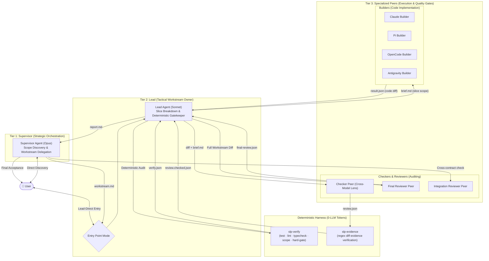
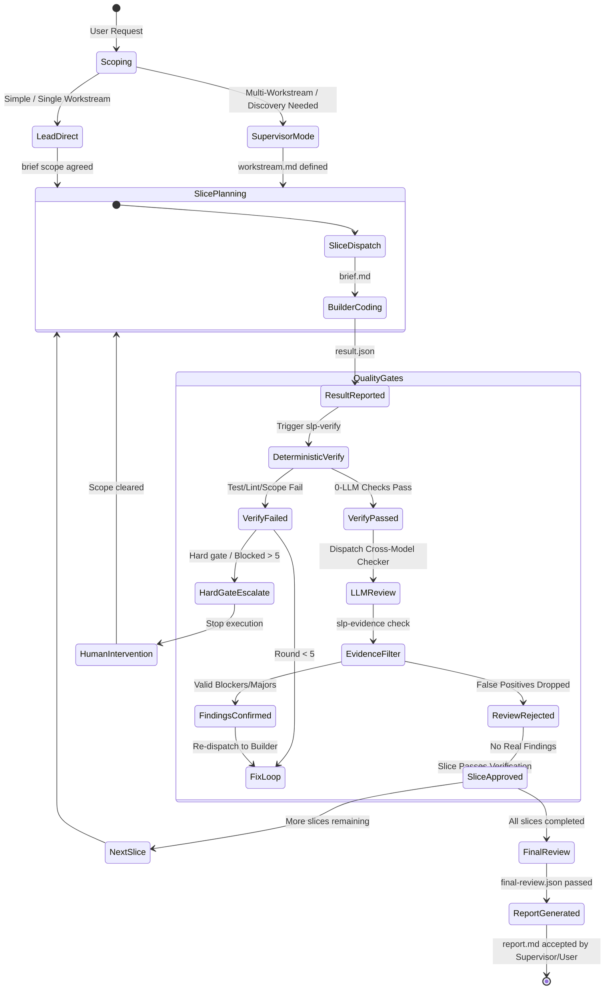

# paseo-slp

Per-role harness for Paseo agents (Supervisor / Lead / Peers). Spec: `SLP-SPEC.md`.

## Architecture & Flow Overview

### 1. High-Level 3-Tier Multi-Agent Hierarchy

### 2. End-to-End Execution Sequence & Verification Lifecycle

```mermaid
sequenceDiagram
    autonumber
    actor User as 👤 User
    participant Sup as 🧭 Supervisor (Opus)
    participant Lead as 👔 Lead (Sonnet)
    participant WT as 📂 Git Worktree (.slp/)
    participant Bld as 🛠️ Builder (Peer)
    participant Ver as ⚡ slp-verify (Deterministic)
    participant Chk as 🔍 Checker (Peer)
    participant Evi as 🛡️ slp-evidence (Deterministic)
    participant Fin as 🏁 Final Reviewer

    rect rgb(30, 41, 59)
    note over User, Sup: Phase 1: Discovery & Scoping
    User->>Sup: Request feature / Complex multi-workstream task
    Sup->>Sup: Discovery (Grill, Options, Edge cases)
    Sup->>WT: Write .slp/workstream.md (scope, acceptance, gates)
    Sup->>Lead: Spawn Lead agent
    end

    rect rgb(15, 23, 42)
    note over Lead, Ver: Phase 2: Slice Execution & Deterministic Verification
    Lead->>Lead: Break workstream into slices (<= 8 files)
    Lead->>WT: Write .slp/slices/<id>/brief.md (with inline code context)
    Lead->>Bld: Dispatch Builder (isolated branch, push blocked)
    Bld->>Bld: Implement code + run local slice tests
    Bld->>WT: Write .slp/slices/<id>/result.json
    Bld-->>Lead: Hand-off completed slice
    Lead->>Ver: Execute slp-verify <worktree> <slice-id>
    Ver->>Ver: Run repo test + lint + typecheck + scope check
    Ver->>WT: Write .slp/slices/<id>/verify.1.json
    Ver-->>Lead: Verdict (pass | fail | block)
    end

    rect rgb(30, 41, 59)
    note over Lead, Evi: Phase 3: Cross-Model Review & Evidence Filtering
    Lead->>Chk: Dispatch Checker (Different model family than Builder)
    Chk->>Chk: Multi-lens review (business, security, perf, scale)
    Chk->>WT: Write review.1.json
    Lead->>Evi: Run slp-evidence review.1.json
    Evi->>Evi: Verify line numbers & quote evidence in diff
    Evi->>WT: Write review.1.checked.json (filter hallucinated issues)
    opt If issues detected (Fix Loop)
        Lead->>Bld: Re-dispatch with review findings (Round 1-3 Cheap, 4-5 Sonnet)
    end
    end

    rect rgb(15, 23, 42)
    note over Lead, User: Phase 4: Integration, Final Review & Reporting
    Lead->>Lead: Merge slice branch into workstream branch locally
    Lead->>Fin: Dispatch Final Reviewer on full workstream diff
    Fin->>WT: Write final-review.json
    Lead->>WT: Write .slp/report.md (summary, metrics, acceptance checklist)
    Lead-->>Sup: Report workstream completion
    Sup->>User: Deliver verified result with audit trail
    end
```

### 3. State Machine & Escalation Loop

## Layout
- `roles/<role>/role.md` role prompt (EN, <= 60 lines, line 1 = `ROLE-MARKER: slp-<role>`)
- `roles/<role>/policy.yaml` harness policy (write / bash / paseo_tools / skills_auto / deny_tools / probe)
- `roles/extra_skills.yaml` bundled skills (not in `~/.claude/skills`) that are switched off in Claude roles
- `bin/slp-build` generates `build/` + provider JSON and installs the slp-* skills; `bin/slp-conformance` probes every provider
- `skills/slp-lead/`, `skills/slp-supervisor/` operating playbooks (symlinked into `~/.claude/skills` by `slp-build --apply`)
- `bin/slp-verify` / `bin/slp-evidence` / `bin/slp-validate` deterministic verification tools (see below)
- `schemas/` JSON Schema (draft 2020-12) for every artifact; `templates/` one valid example of each
- `repos/_default.yaml` hard-gate + sandbox-escape patterns (DRAFT); `repos/TEMPLATE.yaml` per-repo config
- `lib/` shared Python modules (`slp_schema`, `slp_git`, `slp_rules`, `slp_policy`, `slp_paseo`, `slp_skills_install`, `slp_git_push_block`) + `paseo_remove_project.mjs`
- `tests/` unittest suite over throw-away fixture git repos
- `hooks/slp-guard.py` Claude PreToolUse guard (Bash / Edit / Write) + SessionStart prompt delivery
- `build/` generated, never hand-edit. `conformance/` probe results.

## Workflow
1. Edit `roles/<role>/role.md` or `policy.yaml` (single source per role).
2. `bin/slp-build` dry run: writes `build/`, prints providers JSON + diff vs `~/.paseo/config.json`.
3. `bin/slp-build --apply` writes ONLY `agents.providers.slp-*` (+ the `antigravity` override) in `~/.paseo/config.json`,
   installs the skills (below), then `paseo reload`. The config backup `build/config-before-apply.json` is only
   rewritten when the config actually changes (an idempotent re-apply keeps the real "before" copy).
   (Claude settings/policy files are read at agent start; only provider argv/env need the reload.)
4. `bin/slp-conformance [--roles a,b]` spawns one cheap probe per provider (read-only roles also get an
   `@bypass` probe so plan mode cannot mask the harness), judges from the filesystem + self-reports,
   writes `conformance/conformance-<ts>.json`, archives probe agents, exits 1 on any FAIL.
   Run it after every build, Paseo update, mobio-kit update or profile change.
   All probes share ONE scratch cwd (`.scratch/conformance`, gitignored; probe files are named per variant) so
   Paseo creates a single workspace/project. At the end the probe agents are archived and the scratch project
   is removed via the daemon API (`lib/paseo_remove_project.mjs`, installed CLI client `removeProject`) and the
   scratch dir is deleted. The Lead probe also proves `slp-verify` / `slp-evidence` can run (output files on disk)
   while any other bash is blocked.
   The scratch dir is a throw-away git repo with a second worktree (`wt-sibling`) inside it: the Lead probe must be able
   to write `wt-sibling/.slp/` but not `wt-sibling/` source files; checker roles must write only their own `.slp/review.*`
   file (not the sibling's, not elsewhere; bash writes blocked); `codex-checker@review` asks for a real review of a
   fixture diff and requires the final message to be schema-valid review JSON (`slp-evidence` kept/rejected is reported).
   Result files never overwrite each other (`-2` suffix within the same minute).

Python: `~/.claude/skills/.venv/bin/python3` (stdlib + PyYAML). Profiles are NOT switched by these tools.

## Git-level push block (`git_push_block: true`)
Set on `claude-builder`, `pi-builder`, `opencode-builder`. `slp-build` adds to those providers' `env` (merged with any
existing `GIT_CONFIG_*` / policy `env:` pairs and renumbered; idempotent; `lib/slp_git_push_block.py`):
`GIT_CONFIG_COUNT=9` and for i in 0..8 `GIT_CONFIG_KEY_i=url.nopush:///.pushInsteadOf` with `GIT_CONFIG_VALUE_i` =
`git@`, `https://`, `http://`, `ssh://`, `file://`, `/`, `./`, `../`, `git://`. Every push URL is rewritten to the
non-existent `nopush` transport, so git itself fails (`remote helper 'nopush' aborted session`) no matter how the push
is spelled (alias, `git -c`, script, `-C`); `fetch` / `commit` are unaffected. `./`, `../`, `git://` go beyond the
required list (relative-path and git:// remotes would otherwise slip through).
- Known limits: git does NOT apply `pushInsteadOf` to an explicit `remote.<n>.pushurl`; an agent that sets one, unsets the
  env (`env -u`, `GIT_CONFIG_COUNT=0 git push`) or uses a non-git client is not stopped by this layer. Claude keeps the
  guard-hook deny on `git push`, Pi relies on this layer + `slp-verify`.
- OpenCode: the env is added too, but it is NOT reliable there. Paseo's `OpenCodeServerManager` is a process-wide
  singleton (fork `packages/server/src/server/agent/providers/opencode/server-manager.ts:120-138`): the first
  OpenCode-family client fixes the runtime settings (later providers only get a warning) and `startServer` builds the
  shared server env from them (`:338-342`). Per-provider env therefore reaches `opencode serve` only if
  `slp-opencode-builder` was constructed first. A dedicated server is used only for per-agent launch env / MCP servers
  (`opencode-agent.ts:358-361`, `:1608-1613`), which does not carry provider env. So the OpenCode agent additionally gets
  bash permission `"*git*push*": deny` (last rule, after `"*": allow`; existing deny rules kept) and OpenCode relies on
  that pattern only (it does not catch a push hidden in a script).
- Tests: `tests/test_git_push_block.py` (fixture repos, local bare remote via `file://`, plain and relative path:
  push fails with `nopush`, fetch/commit work; env merge; OpenCode rule order; conformance judge).
- Conformance: `claude-builder@git_push` / `pi-builder@git_push` run `git push origin HEAD` and
  `git -c alias.pp=push pp origin HEAD` in a scratch repo whose `origin` is a local bare repo (`file://`). PASS =
  the bare repo did not receive the commit (checked from the filesystem, with a control push proving the fixture works);
  the evidence says whether the `nopush` error (git layer) or another layer stopped it. `opencode-builder@git_push` is
  UNVERIFIED while its probe has `skip_reason` (quota).

## Skills install (`slp-build --apply`)
- Symlinks `skills/slp-*` into `~/.claude/skills/<name>` (only `slp-*` names; a stale or dangling `slp-*` symlink is
  replaced/removed; a real directory with that name is refused; other skills are never touched).
- `~/.claude/settings.json`: ensures ONLY `skillOverrides["slp-supervisor"]` and `["slp-lead"]` = `user-invocable-only`
  (global default: hidden in normal sessions). The dry run prints the exact diff; other keys are re-serialized only.
- Per role, `build/claude/<role>.settings.json` sets EVERY `skills_auto` entry explicitly to `"on"` (supervisor gets
  `slp-supervisor`, lead gets `slp-lead`), so the global `user-invocable-only` does not hide them; all other known
  skills are `"off"`.

## Paseo CLI resolution
Scripts that call the Paseo CLI/client (`bin/slp-conformance`, `bin/slp-build` reload, `lib/paseo_remove_project.mjs`)
use `lib/slp_paseo.py`: env `PASEO_CLI` if set; else the sibling fork CLI
`<WORKSPACE_DIR>/paseo/packages/cli/bin/paseo` when its `dist/index.js` exists; else
`/opt/homebrew/bin/paseo` with a warning (it may be older than the daemon, 0.10.3 vs 0.11.2, and rejects the current
config). The `removeProject` client import follows the same order (`<cli>/dist/utils/client.js`; `SLP_PASEO_CLI_DIST`
overrides).

## Guard rules (`hooks/slp-guard.py`, driven by `roles/<r>/policy.yaml`)
- Bash modes: `none`; `allowlist` / `readonly` (regex allowlist over the normalized segment; no redirections,
  substitutions, `;` `&&` `||` `|` `&`, newlines or nested shells; NO env prefix / `sudo` / `env` / `command`
  wrappers, so `VAR=x slp-verify` is refused); `all-except` (builders: deny patterns for `git push`, `reset --hard`,
  `branch -D`, merge/rebase/pull/checkout of protected branches, destructive `rm`; wrappers are stripped first).
  Absolute paths of `slp-verify` / `slp-evidence` under `paseo-slp/bin/` match as the bare name.
- git branch protection uses the directory of `git -C <dir>` (so a Lead in the main checkout can run
  `git -C <worktree> merge <slice-branch>`); `--git-dir` / `--work-tree` are refused.
- `write: slp-only`: `Write|Edit|MultiEdit` only under `.slp/` after `realpath` (symlinks and `..` cannot escape);
  `NotebookEdit` always refused. `slp_scope: cwd` (Claude checkers/reviewers) = `.slp/` of the agent's own workspace;
  `slp_scope: repo` (Lead) = `<toplevel>/.slp/` of ANY worktree whose
  `git rev-parse --path-format=absolute --git-common-dir` equals that of the cwd / `CLAUDE_PROJECT_DIR`
  (sibling worktrees yes, other repos no, `src/` never).
- Claude checkers/reviewers (`claude-checker`, `claude-final-reviewer`, `claude-integration-reviewer`): write
  `slp-only` (their own `review.<round>.json` / `final-review.json` / `integration-review.json`), bash `readonly`,
  probe mode `bypassPermissions` (profiles still in `plan` mode refuse the write; switch them).
  `codex-checker` (provider `slp-codex-checker`): Codex read-only sandbox, replies with ONE JSON object that the
  Lead saves.

## Known wiring facts (Paseo 0.11.2 / Claude 2.1.299 / Codex 0.160)
- Claude: Paseo's own `--append-system-prompt` wins over ours; the role prompt reaches the model through the
  SessionStart hook (marker `ROLE-MARKER-HOOK:`). Our flag is kept as a harmless first channel.
- Codex: Paseo sends developerInstructions per thread (overrides `-c developer_instructions`); the role is
  delivered via `-c model_instructions_file=<role.md>`. No modeId on the profile (sandbox_mode via `-c` holds).
- OpenCode: Paseo's server manager is a process-wide singleton; per-provider `env` is ignored for mode
  discovery (and unreliable for the shared server, see the git push block), so `modeId: slp-builder` is rejected ("Available modes: build, plan, brainstormer").
- Antigravity: Paseo rejects `extends: "antigravity"`, so slp-build OVERRIDES the built-in plugin provider key
  `agents.providers.antigravity` = `{command: ["agy","--agent","slp-agy-builder"], paseoTools: {enabled: false}}`
  (an entry without `extends` is a plain override; verified on a throw-away 0.11.2 daemon: argv = `agy --agent
  slp-agy-builder` + Paseo's flags). Consequence (accepted): EVERY Antigravity agent started via Paseo is the SLP
  builder. `antigravity` is the only non-slp key slp-build writes, and only its command/paseoTools/label fields.
  `--apply` also installs `build/antigravity/slp-*.md` into `~/.gemini/config/agents/` (checks `agy agents`) and backs
  the config up to `build/config-before-apply.json`. Note: the global `/opt/homebrew/bin/paseo` (0.10.3) CLI rejects
  such a config; use the 0.11.2 CLI for `daemon start --home`. The plugin has no `prompt.output_schema`, so the
  conformance probe reads the JSON from `paseo logs`. Probe conversations are deleted via their summary row
  (workspace_uris = scratch dir); empty-workspace `slp-agy-builder` rows come from Paseo's catalog calls and stay.
- Codex peers: `features.multi_agent=false` alone does NOT remove spawn_agent for v2 models; slp-build also passes a
  generated catalog without `multi_agent_version` (`build/codex/catalog.json`, regenerated every build).
- Gaps: MCP per role out of scope; Codex/Pi skills not controllable here.

## Verification tools (P2)
Run with `~/.claude/skills/.venv/bin/python3` (shebang already set). Needs PyYAML + jsonschema (both in that venv).

`bin/slp-verify <worktree> <slice-id> [--round N] [--repo-config PATH]` (0 LLM). Reads
`.slp/slices/<id>/brief.md` front-matter, diffs `base_ref...HEAD` + uncommitted + untracked, writes
`.slp/slices/<id>/verify.<round>.json` (default round = next free). Exit 0 pass, 1 fail, 3 block, 2 usage/internal.
`bin/slp-verify --init <worktree>` appends `.slp/` to `<git common dir>/info/exclude` (idempotent, exit 0, prints what
it did); run it once per worktree (the Lead is allowed to).

Checks: `test` `lint` `typecheck` (repo config; missing => `unconfigured`, never a pass; use `{skip: "why"}` to
skip on purpose), `scope` (changed files subset of brief.files, `.slp/` allowed), `writer_conflict` (other
`.slp/slices/*/brief.md` with the same `parallel_group`), `hard_gate` (=> `block`, escalate), `sandbox_escape`
(=> `fail`), `contract` (result.json exists + schema). Verdict: block > fail/unconfigured > pass.
`--repo-config` must live OUTSIDE the worktree (otherwise a Lead could run arbitrary commands by writing a
config under `.slp/`).

`bin/slp-evidence <review.json> <worktree> [--brief PATH] [--base REF]` keeps findings whose file is in the
diff/brief.files, whose line exists at HEAD (working tree for files with uncommitted edits) and whose `evidence`
(whitespace-normalised, >= 4 chars) appears within +-3 lines. Writes `<review>.checked.json` (`review.1.json` ->
`review.1.checked.json`) with `findings` kept and `rejected[{finding,reason}]`. Use `--base <base_branch>` for
`final-review.json` (no brief). Exit 0; 2 on bad input.

`bin/slp-validate <file> [--kind K]` validates any artifact against `schemas/` (markdown: front-matter only).

Repo config: `repos/_default.yaml` (DRAFT hard-gate + sandbox patterns, needs team review) is merged with
`repos/<repo>.yaml` (copy `repos/TEMPLATE.yaml`). `<repo>` = basename of the parent of
`git rev-parse --path-format=absolute --git-common-dir`, so worktrees map to the main repo. No real repo config
exists yet (pilot repo not chosen).

Artifacts: JSON ones (`result`, `verify`, `review`, `final-review`) are plain JSON; markdown ones (`workstream.md`,
`brief.md`, `report.md`) have a YAML front-matter block (machine fields, schemas `*.frontmatter.schema.json`)
and a free-text body. Quote YAML strings that contain `: `.

## Tests
`~/.claude/skills/.venv/bin/python3 -m unittest discover -s tests -v` (pytest is not installed in that venv).
`tests/test_slp_guard.py` needs `build/claude/lead.policy.json` for its end-to-end case (run `bin/slp-build` first;
that one test is skipped otherwise).
Fixture repos are created in temp dirs and deleted afterwards; real repos are never touched.
